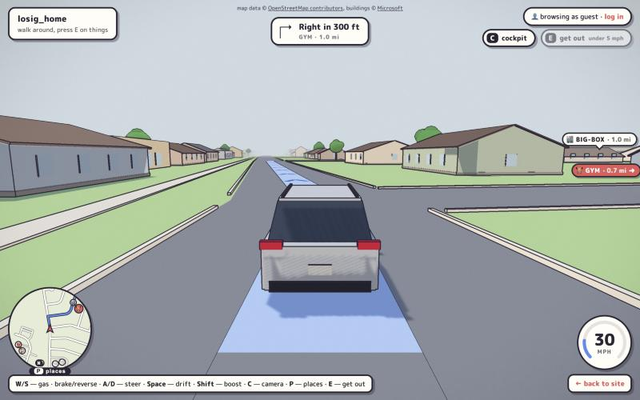
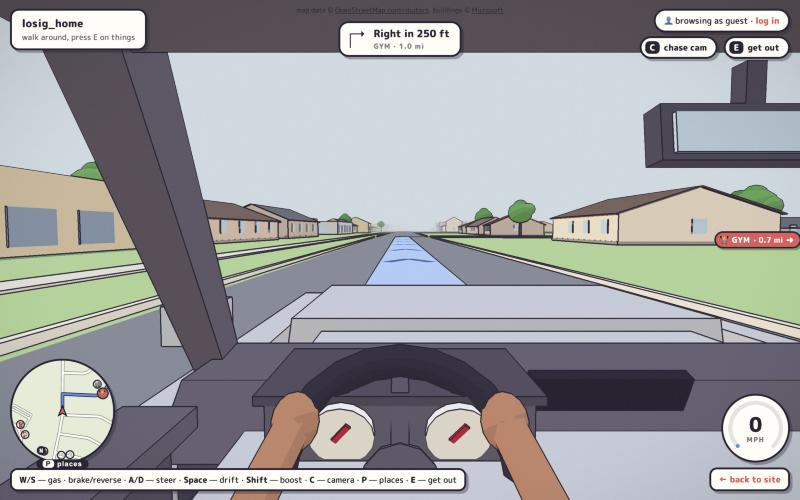
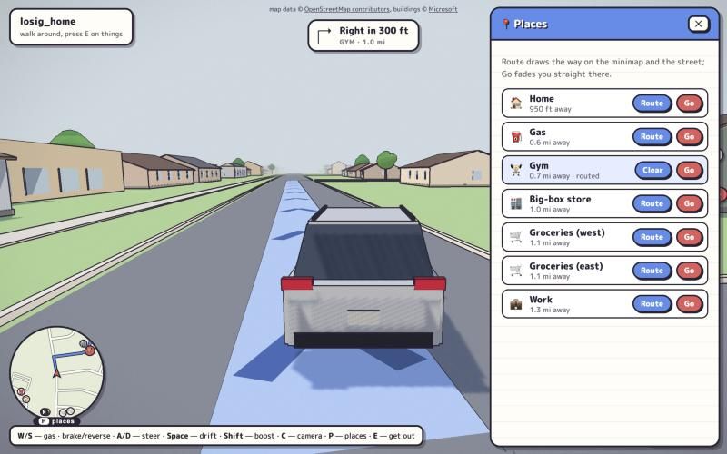
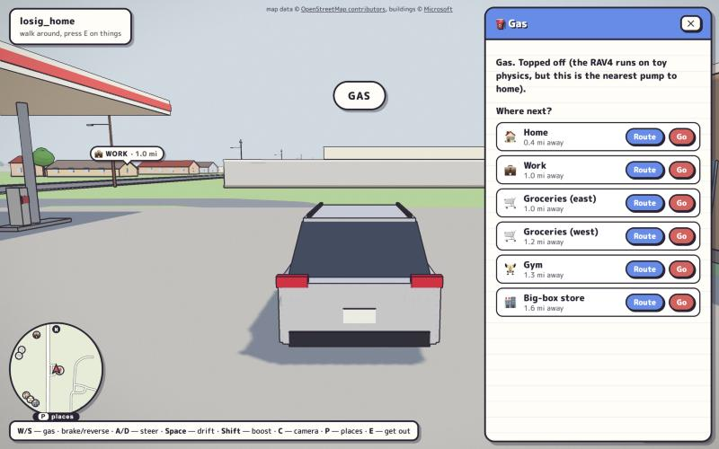
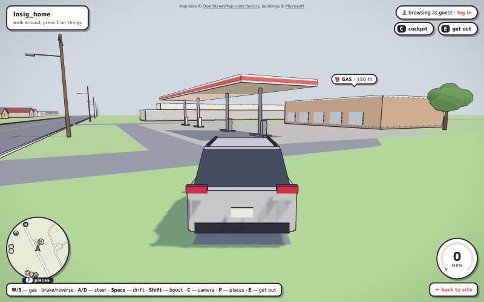
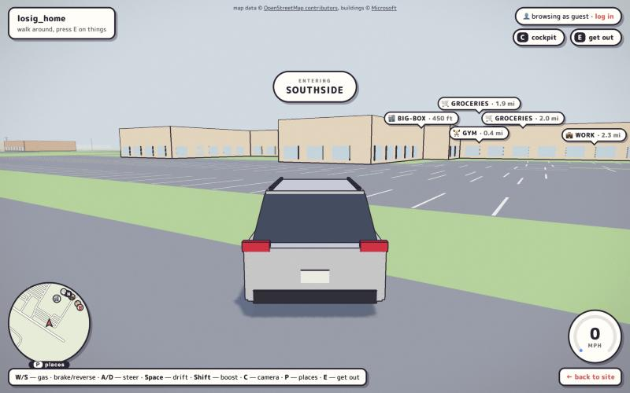
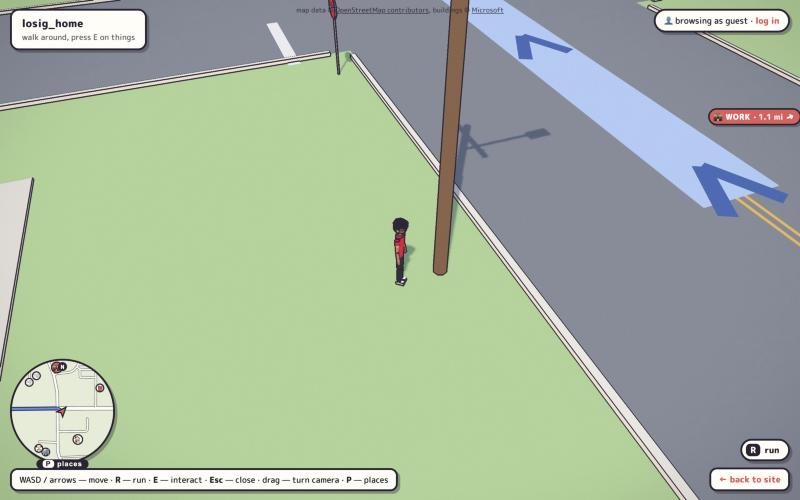
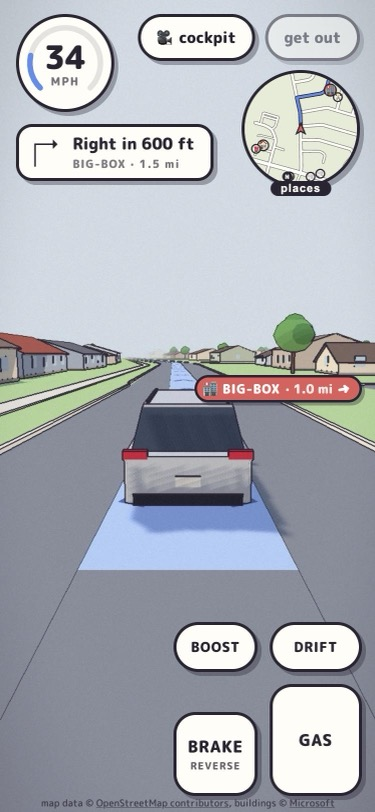
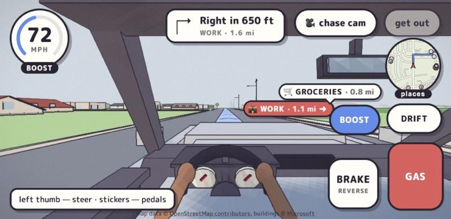

# Outdoor phase: walking out and driving around town

The apartment game's second phase: walk out the front door into the
parking lot, get in the RAV4, and drive anywhere in my real hometown,
with Home, Work, the gym, gas, two groceries and the big-box store
marked, a minimap, routes and fast travel.

This doc is the working design. The research behind it (aerial imagery
notes, routes, data coverage) lives in a private write-up, because the
repo and `/game` are both public.

## Privacy rule

The world is built from the real map, but **no street addresses, unit
numbers, street-corner names, town name or coordinates** go into anything
committed (code, docs, PR text) or shown in the UI. Places are labeled
Home / Work / Gym / Gas / Groceries / Big-box store, and neighborhoods get
compass names (Downtown, Eastside...). Positions are feet from a local
reference point; no business names, not even in the arrival panels.
`tests/test_game.py::test_game_ships_no_real_addresses_or_coordinates`
enforces this for the shipped game files, the baked town data and the
bake script. The bake (`scripts/build_town.py`) reads the origin, bounds
and data files from `instance/town/settings.json`, which is gitignored,
reads only shapes and a few class tags from OSM (never names or
addresses), and tests check that the baked chunks hold nothing but
numbers and a short list of class words, that the street graph is
numbers only, and that the Places carry only the generic names.

## Data sources

| Source | Used for | Ships? |
|---|---|---|
| OpenStreetMap (Overpass) | roads, sidewalks, POIs, rail, water, some buildings and poles | yes, ODbL: "© OpenStreetMap contributors" credit is shown outdoors; baked data stays ODbL |
| Microsoft Global ML Building Footprints (two zoom-9 tiles) | the ~95% of buildings OSM is missing | yes, ODbL: "buildings © Microsoft" is in the outdoor credit; `town/NOTICE.md` marks the baked data as an ODbL derivative |
| USGS NAIP aerial imagery | measuring hand-built sites (the home lot) | geometry derived from it, yes (public domain); never used as a texture |
| Google Maps satellite / Street View / directions | looking and route timings only | **no**: its terms forbid tracing or deriving data from it |

## Style guide (what the apartment does, and how it carries outdoors)

- **Engine:** Three.js r160 ES modules from an import map, no build step,
  real 3D in feet.
- **Shading:** `MeshToonMaterial` with a hard 4-texel ramp, which gives
  three flat bands. There are no image textures. Canvas textures are used
  only for lettering (labels, jersey, signs). Use `pencil(color)`, or
  `pencil(0xffffff, {vertexColors: true})` for merged scenery.
- **Line art:** a screen-space ink pass (`ink.js`), depth silhouettes plus
  normal creases in `#2a2433`. The fade band is set per area and mode:
  55–110 ft inside, 200–520 ft outside on foot, 260–950 ft driving.
- **Grade:** saturation ×1.15, blacks lifted toward violet, paper grain,
  vignette, no tone mapping.
- **Light:** sky-blue hemisphere fill and a warm sun with crisp PCF
  shadows. Outdoors the shadow box follows the player, snapped to texels.
- **Atmosphere:** sky and fog `#dde9ec`. Fog runs 170–560 ft on foot and
  420–1,600 ft while driving, and thickens into a fog bank past the edge of
  the map instead of an invisible wall.
- **Geometry:** primitives only (boxes, 14-sided cylinders, 10-sided
  cones, detail-1 icosahedra), real proportions, toy-simple, one
  recognisable part per box.
- **Outdoor palette:** grass `#a9c98b`, asphalt `#7d8188`, drives
  `#8f9399`, lot concrete `#bcb8b0`, sidewalk `#dcd8cf`, crops `#93b56c`,
  tall grass `#b9c28c`, siding `#a7b6c4`, shingles `#7f6a5d`. House siding
  comes from a small pastel set. Glass, doors, leaves, trunks, paint and
  yellow line reuse the apartment's colors.
- **Cockpit:** warm gray plastic (`#5a5560` / `#45414b`), a cloth
  headliner, white gauge faces with jersey-red needles, and Ani's hands on
  the wheel at ten and two.
- **HUD:** reuse the tokens `--ink --paper --sky --accent --blue`: paper
  boxes with a 3 px ink border and a 4 px offset sticker shadow. The
  prompt is the manga speech bubble, and new pieces (arrival caption,
  speedometer, pedals, camera and Get out chips) are the same stickers.
  The speedometer is a round sticker whose dial fills blue, then red past
  100 mph.
- **Getting around (Phase 4):** place markers are small paper pills with a
  tail ("🏋️ GYM · 0.4 mi"); the routed one turns accent red. The minimap
  is a round sticker: pale-grass paper, streets as paper-white bands with
  an ink edge, the route in `--blue` over ink, place pins, an ink N tab
  and a red arrow for you. The turn card is a sticker with a big arrow
  glyph that turns blue when a turn is close. The route on the ground is
  a pale blue band (`#a9c4f5`) with deeper blue chevrons (`#4a7be6`), flat
  like paint, so the ink pass leaves it alone except for its edges.
- **The one tension:** the apartment is drawn for a high, fixed dollhouse
  camera. Outdoors keeps that camera on foot. A building or tree between
  the camera and the player sinks to the apartment's 4 ft cutaway height
  and shows a hollow interior, the same trick as the apartment walls.
  Driving cameras will pull in instead of cutting.

## Technical design

- **Areas:** each walkable place (`world.js` apartment, `outside.js` lot)
  is an area with its own scene, colliders, bounds, doors, speed, ground
  height and camera framing. Doors are interactables with a `go` target.
  Using one fades to black, swaps the area and shows an arrival caption.
  The outdoors module loads on first exit.
- **Batching:** static scenery merges into vertex-colored meshes
  (`batch.js`) cut into 400 ft tiles, so off-screen tiles, and tiles
  outside the sun's shadow box, get culled. Things that change stay
  separate: cuttable buildings and trees, and the RAV4. Ani is baked into
  one mesh per moving part (`mergeMeshes`), 12 draw calls instead of ~130.
- **Ground layers:** flat ground (grass, water, fields, drives, streets,
  lots, paint) is one mesh per area or chunk whose vertices carry a
  `layer`; the shader pushes deeper layers back by a fixed depth step
  (`batch.js` GROUND). From the driver's seat, surfaces a fraction of a
  foot apart would otherwise z-fight a few hundred feet out, and one mesh
  is one draw call instead of five.
- **Primitives:** boxes, flats, discs, cylinders, blobs and gable attics
  are cached unit shapes copied and scaled, so building a street of houses
  doesn't construct thousands of geometries.
- **Scale:** true 1:1. The car is tuned instead: 0–60 mph in 4.5 s,
  0–100 in 8 s, top speed 160 mph (deliberately silly; it's a toy).
  Expected drives at a sensible pace are about 30 s to the gas station,
  about 75–90 s to the gym, and about 90 s to work; fast travel (Phase 4)
  skips them. Boost (Shift, or the sticker) lifts the top speed to
  205 mph and pulls 1.5× as hard.
- **The bake** (`scripts/build_town.py`, Python standard library + curl):
  - One Overpass query for the town's bounds (roads, sidewalks, buildings,
    land cover, water, rail, trees, stops, signals, lamps), cached in
    `instance/town/cache/`.
  - Footprints from the two Microsoft tiles that cover the town. OSM
    buildings win; a footprint is dropped if OSM or a hand-measured
    building already has it.
  - Near-rectangles (about 90% of buildings) become boxes with gable,
    low or flat roofs and real height where the data has one; odd shapes
    extrude as flat-roofed blocks with storefront glass.
  - Curbs are worked out offline (gaps at every crossing road and lot), as
    are utility poles every ~180 ft along the bigger streets, stop signs
    where a residential street meets one, signal masts at mapped signals,
    and trees (mapped ones, woods filled on a grid, and some yard trees).
  - The hand-built blocks are a hole: roads, land, trees and furniture
    inside nearby.js's REGION are cut out exactly at its edge, so the
    streets join seamlessly.
  - OSM maps most lots here only by their aisles (29 parking areas, 104
    parking aisles), so each `service=parking_aisle` bakes as an `aisles`
    line: a 58 ft paved band (the lane plus a row of stalls each side)
    with stall stripes every 9 ft, counted as pavement, kept free of trees.
  - Output: 1,008 chunks of 600 ft, 1.6 MB of JSON in total (11,950
    buildings, 3,800 road pieces, 1,491 props), plus `town/roads.json`.
  - **The street graph** (`roads.json`, 152 kB, 57 kB gzipped): a vertex
    wherever ways meet or end (3,288), an edge with its simplified shape
    between (4,620), and a class per edge (collector, residential,
    service, drive). Unlike the chunks it keeps the hand-built blocks:
    the minimap and the router need the whole town.
- **Streaming** (`chunks.js`): chunks load in a ring around a look-ahead
  point (1,200 ft on foot; 1,800 ft driving, centered 1.5 s ahead of the
  car), nearest first, and unload 500 ft beyond. Building is a generator
  stepped within a ~4 ms budget per frame (worst measured frame 5.5 ms).
  At 158 mph every chunk within 900 ft of the car was always built; the far
  ring catches up behind the fog. Each chunk is three draw calls: static
  scenery, layered ground, and its breakable props.
- **Collision per chunk:** each chunk builds its own 40 ft grid; `collide.js`
  `createWorld` queries the hand-built area plus whichever chunks a circle
  (plus 150 ft of overhang) can touch. Odd-shaped buildings collide as
  polygons. Each chunk also brings its sidewalk heights and a 4 ft
  pavement raster for the grass drag.
- **Physics** (`vehicle.js`): no engine; 2D arcade physics on a flat
  ground plane at a fixed 60 Hz, drawn interpolated between steps.
  - The car collides as three circles (r 3.05 ft, along its length)
    against boxes, axis-aligned or turned, from a 40 ft grid
    (`collide.js`). Hits push out, bounce with restitution 0.3, scrape
    with a little friction, spin the car from where they land, and shake
    the camera (trauma squared). Fast moves are sub-stepped so 160 mph
    can't tunnel through a pole.
  - A bicycle model handles steering. Lock narrows with speed so the
    fronts never ask for more than about 1.6 g: a 38 ft turning radius at
    30 mph, 150 ft at 60, 600 ft at 120.
  - Grip swings the velocity back toward the heading, keeping speed. The
    handbrake (Space / Drift) cuts grip and lets the car over-rotate to a
    held ~45° slide; letting go straightens it within a second.
  - Holding brake at a standstill reverses (up to 20 mph). Grass is
    drivable but drags the car down to about 70 mph (a 4 ft pavement
    raster answers "is this road?").
  - Curbs and sidewalks don't collide; the body bumps up 3 in onto
    sidewalks.
  - Breakables (`breakables.js`): utility poles, lot lights, stop signs,
    the bus stop and signal masts. Hit one above 8 mph and the car loses
    15% of its speed while the prop's vertices collapse out of its merged
    mesh and a copy topples from the base the way you were going (light
    signs fly off spinning). Pieces lie there 20 s, then shrink away;
    knocked props stay down for the visit. Slower than 8 mph they're
    solid.
- **Cameras:** every camera writes a wanted pose each frame and `main.js`
  blends any change (0.75 s getting in, 0.6 s getting out, 0.4 s toggling).
  - On foot: the follow camera, closer outdoors (27 ft up, 25 back).
    Outdoors it swings around Ani (drag the mouse, or a second finger on
    touch) and walking turns with it; the apartment keeps its fixed angle.
  - Cockpit (`drive.js`, the default): at the driver's eye, glancing a
    little into turns, FOV widening slightly with speed. Phones in
    portrait start in chase instead, because a portrait cockpit is mostly
    headliner and dash.
  - Chase: trails on a lagging yaw (wider in drifts), 22 ft back and
    7.5 ft up, backing off and widening its FOV from 58° to 74° with
    speed. A wall between it and the car pulls it in, up and looking
    further down the road, instead of the cutaway.
  - `C` or the camera chip toggles.
- **Getting in and out:** the driver's door is an interactable that
  follows the car ("Get in": E or tap the bubble). Ani shrinks into the
  seat. Get out (E or the chip) only works under 5 mph and puts Ani at the
  driver's door, or the passenger side, behind or in front if that's
  blocked. The parked car joins the collision grid as three moving circles.
- **Touch driving:** a floating steer stick (sideways only) that starts on
  the left 62% of the screen; Gas, Brake/Reverse, Drift and Boost stickers
  on the right, each tracking its own finger so any combination can be
  held; the camera and Get out chips at the top right, the speedometer top
  left.
- **The hand-built blocks** (`nearby.js`, built by `town.js`): the cross
  street from the stadium to the signalled corner (about 3,250 ft), the
  avenue north past the church grounds and south around its bend, and the
  side streets between. Roads and sidewalks are OSM centerlines with
  names dropped; about 55 buildings, the lots, fields, tree stands, the
  stadium and the ball diamond are measured off NAIP. Since Phase 3 the
  houses between them are real footprints from the bake, and the town
  continues past every edge.
- **The edge of town:** the drivable map is the baked bounds (about
  19,000 × 20,000 ft). A fog bank closes in over the last 400 ft and the
  car bogs down instead of hitting an invisible wall. The grass is one
  quad under the whole town and on into the fog (until Phase 4 it only
  reached 2,000 ft past the hand-built blocks, so most of the town stood
  on bare sky-colored ground).
- **Places** (`places.js`): each place is a marker anchor over its
  building, a parking spot (facing the door) and an arrival radius, all
  in feet. The offsets were checked against the baked footprints: Work,
  both groceries and the big-box store land inside their buildings, the
  gym inside a long strip of storefronts, gas on its store.
  - The stores' lots aren't in the data, so Work, the gym and both
    groceries get a paved pad with stall rows beside the building
    (placed in open ground next to the nearest drive, not measured);
    the big-box store already has paved aisles. The gas station's canopy
    bakes as a solid 22 ft block, so `chunks.js` skips that footprint
    (a small restyle list) and the place draws a canopy on four posts with
    pump islands over a concrete pad; its store gets a one-story shop look.
  - Markers are HTML over the canvas, projected each frame: fog never
    washes them out and the text stays crisp. Nearest first, a label that
    would overlap a nearer one stacks above it, and one that would land on
    a HUD sticker slides in off it. The routed place pins to an inset
    frame at the screen edge (with an arrow) when it's off screen or
    behind; standing at a place hides its own label.
  - Arriving: stop under 3 mph for 0.7 s (or walk in) within the routed
    place's radius, or near any other place's parking spot. That shows the
    caption and a drawer panel: a line, the apartment's training panel at
    the gym or today's meals at the groceries, then "Where next?". A place
    arms only after you've been well outside it, so leaving home or
    sitting in a lot doesn't repeat it.
  - Neighborhoods: seven generic rectangles (Downtown, Northside,
    Westside, Southwest, Midtown, Eastside, Southside) plus "Edge of town"
    within 1,200 ft of the bounds. Inside a new one for 1.2 s puts up the
    caption with an "entering" kicker.
- **Minimap** (`minimap.js`): a 2D canvas redrawn up to ~32 times a second
  from the street graph, only the edges in the 500 ft grid cells around
  you (a few hundred segments). Driving it turns heading-up and zooms from
  about 700 to 2,000 ft with speed; on foot it's north-up at 520 ft.
  Desktop: bottom left above the help line. Phones: top right (under the
  login pill on wider screens), below the camera chips while driving, and
  shrunk to sit over Drift on landscape phones (hidden under 345 px tall).
  Tapping it (or P) opens the Places list.
- **Routes** (`roads.js`, `route.js`): A* over the street graph from the
  nearest point on a street to the street nearest the parking spot, then
  straight into the spot. Cost per foot by class (collector 1, residential
  1.15, service 1.6, drive 3) and a straight-line heuristic, so routes
  prefer the big streets. One-way tags aren't baked, so routes ignore
  them. About 6 ms a search.
  - The ribbon is one mesh for the whole route, in 24 ft pieces (a quad
    hundreds of feet long loses the depth fight with the road under it),
    pulled a few depth layers forward like the paint. Every vertex knows
    how far along the route it is and a uniform discards what's behind
    you, so it eats itself as you drive without rebuilding.
  - Progress is the nearest point searched a little behind and ahead of the
    last one; 90 ft off the route for 1.5 s plans it again from where you
    are. The turn card reads the next junction where the way bends more
    than 30° (Left / Right / Bear left / U-turn), "Turn around" when you're
    driving away from it, and "Arriving" in the last 120 ft.
  - Desktop: turn card top center. Phones: under the speedometer in
    portrait, top center in landscape. It only shows while driving.
- **Fast travel:** Go in any Places list fades to black, puts the car on
  the parking spot (Ani at its door when walking, in the seat when
  driving), streams every chunk within 900 ft behind the black with a
  30 ms slice per step (about 0.4–1.2 s locally), snaps the camera and
  fades in on the arrival caption and panel. Arrival and the neighborhood
  banner are reset so they don't fire on top of it.
- **Dynamic resolution** (touch devices, outdoors): every 1.5 s the
  average frame rate decides. Under 50 fps drops the pixel ratio 0.15
  (floor 0.7); over 57 fps climbs 0.1 back toward the 1.5 cap after a
  wait. A step up that drops straight back doubles that wait (8 s up to a
  minute), and the seconds after loading or travel don't count.
- **`/game?stats`:** frame rate, pixel ratio, and draw calls and
  triangles for the color pass and the shadow pass. three.js resets its
  counters after drawing the shadow map, so ink.js counts by hand.
- **Mobile budget** (measured in Phase 2; Phase 3 in town: 35–38 draw
  calls and 64–147k triangles in the color pass, about 10 calls and 46k
  in the shadow pass; Phase 4 with `?stats`: downtown driving 37–40 calls
  and 90–94k triangles in the color pass, 11 calls and 21k in the shadow
  pass; the home lot on foot 27 calls and 138k, shadow 20 calls and 120k.
  The route ribbon is one draw call, the pads and canopy merge into the
  existing batches, and markers, minimap and turn card are HTML and 2D
  canvas, so Places cost almost nothing in the 3D budget):
  - At most 150 draw calls per pass. Driving views run 26–58 in the color
    pass and about 20 in the shadow pass; the whole map from above is
    about 145.
  - About 300k visible triangles. The whole Phase 2 scene is 267k; a
    driving view draws 106–166k plus about 120k in the shadow pass. Trees
    are most of it, so stands of trees use a lighter four-blob tree.
  - Pixel ratio capped at 1.5 outdoors on touch devices, and dynamic
    resolution down to 0.7 to hold 50+ fps (Phase 4).
  - 1024² shadows on touch devices.
  - 2× MSAA on touch devices (done).

## Phases

1. **Out the door and across the lot**: this PR.
   - Area switching with a fade.
   - The home lot measured from OSM plus NAIP: both buildings, stalls,
     spur, driveway, street frontage, sidewalks, trees, lights, parked
     cars, and the RAV4 as a solid prop.
   - Outdoors Ani walks at 9 ft/s; **R** (or the Run sticker on touch)
     toggles a 20 ft/s sprint, also 11 ft/s in the apartment.
   - A "MY RAV4" speech-bubble marker floats over the car.
   - The dollhouse cutaway, the following sun, the OSM credit and a
     privacy test.
2. **A drivable RAV4**: this PR too.
   - Get in and out at the driver's door; the car stays where you leave it.
   - Arcade handling at a fixed 60 Hz: 0–60 in 4.5 s, 160 mph, a handbrake
     drift, brake-to-reverse, wheels that spin and steer, body lean.
   - Cockpit and chase cameras with blends, shake on impact, and per-mode
     fog and ink distances.
   - Three-circle collisions against a grid of boxes; curbs and sidewalks
     are visual only.
   - Touch pedals, a sideways steer stick, and a speedometer sticker.
   - A few blocks of the avenue and cross street to drive, with a fog bank
     at the edges.
   - Ani merged to 12 meshes; outdoor run raised to 30 ft/s (about 20 mph).
3. **The whole town**: this PR too.
   - The bake script and 1,008 baked chunks: roads, curbs, sidewalks,
     land, water, rail, 11,947 buildings, trees, poles and signs.
   - Streaming around a look-ahead point within a per-frame budget.
   - Collision per chunk, polygon buildings, and breakable poles and signs.
   - Real footprints replace the placeholder houses; the fog bank moves to
     the edge of town.
   - Storefront glass on shops, STOP lettering in block strokes.
4. **Places and polish**: this PR too.
   - Home, Work, the gym, gas, two groceries and the big-box store as
     distance stickers, with arrival captions and drawer panels.
   - A round paper minimap from a baked street graph; heading-up driving,
     north-up on foot.
   - A Places list (P or the minimap) with A* routes on the minimap and
     as a ground ribbon, a turn card, and rerouting.
   - Fast travel from the list, with the chunks loaded behind the fade.
   - Dynamic resolution on phones, neighborhood banners, `?stats`.
   - Fixes from the screenshots: grass under the whole town, paved
     parking aisles, parking pads, a real gas canopy.
   - Optional extras, built: Boost (Shift or a sticker, 205 mph) and the
     on-foot camera swing.
5. **Life in town** (next): traffic and pedestrians on the street graph,
   signals that cycle, time of day with lights, and a way home from the
   lot to the apartment door.

## Phase 1 screenshots

| | |
|---|---|
|  |  |
|  |  |
|  |  |

## Phase 2 screenshots

| | |
|---|---|
|  |  |
|  |  |

## Phase 3 screenshots

| | |
|---|---|
|  |  |
|  |  |

## Phase 4 screenshots

| | |
|---|---|
|  |  |
|  |  |
|  |  |
|  |  |

