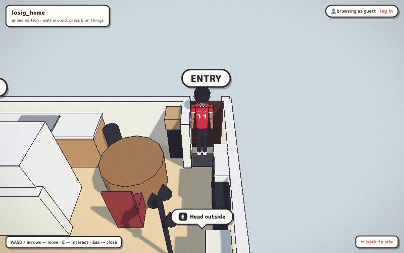
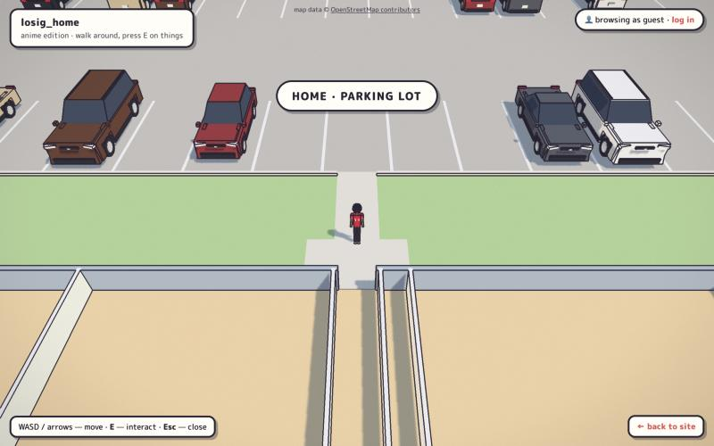
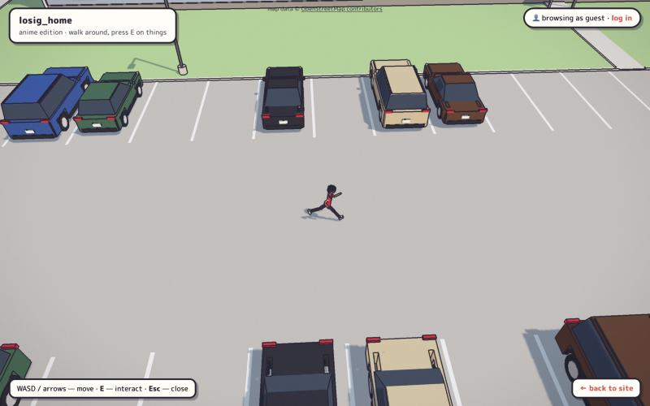
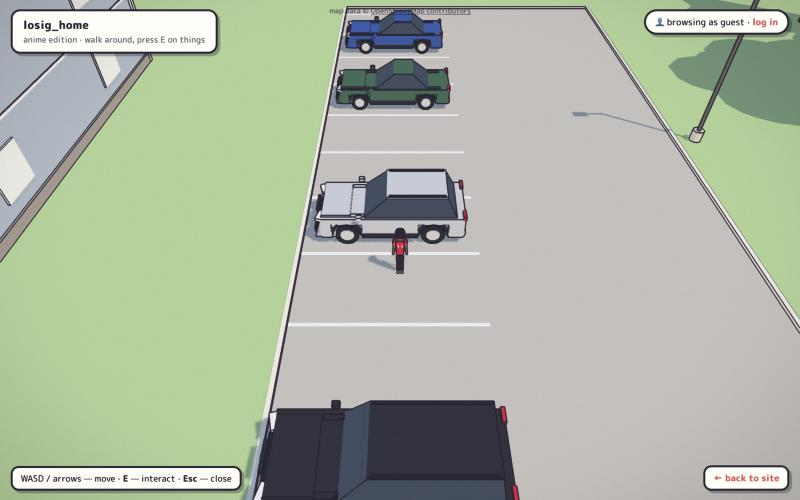
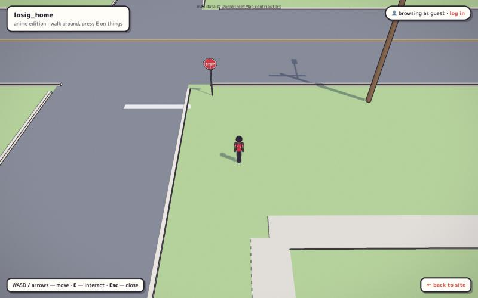
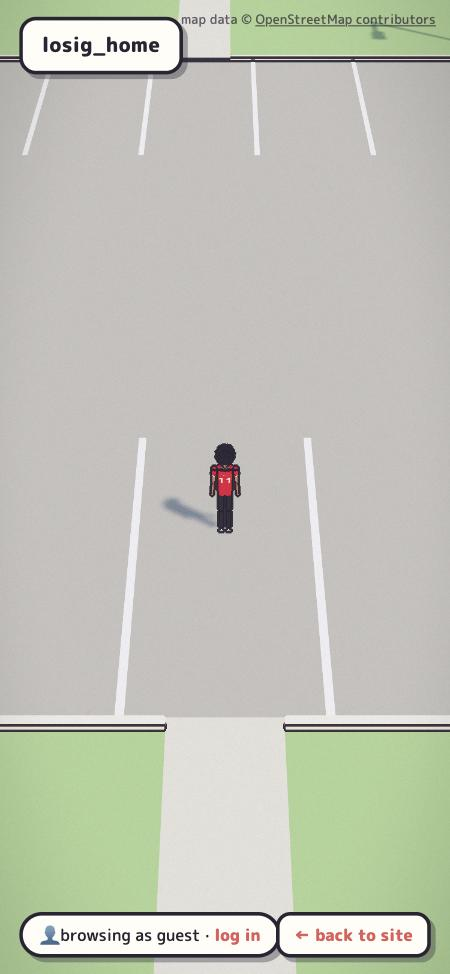
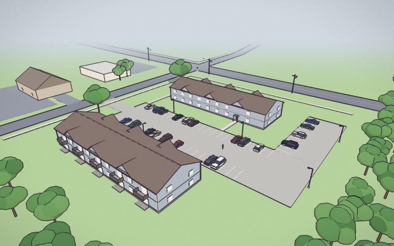

# Outdoor phase: walking out and driving around town

The apartment game's second phase: walk out the front door into the
parking lot, get in the RAV4, and drive anywhere in my real hometown,
with Home, Work, the gym and the nearest gas stations marked.

This doc is the working design. The research behind it (aerial imagery
notes, routes, data coverage) lives in a private write-up, because the
repo and `/game` are both public.

## Privacy rule

The world is built from the real map, but **no street addresses, unit
numbers, street-corner names, town name or coordinates** go into anything
committed (code, docs, PR text) or shown in the UI. Places are labeled
Home / Work / Gym. Positions are feet from a local reference point.
`tests/test_game.py::test_game_ships_no_real_addresses_or_coordinates`
enforces this for the shipped game files. The Phase 3 bake script will
read its origin from an untracked local setting and strip `name` tags.

## Data sources

| Source | Used for | Ships? |
|---|---|---|
| OpenStreetMap (Overpass) | roads, sidewalks, POIs, rail, water, some buildings and poles | yes, ODbL: "© OpenStreetMap contributors" credit is shown outdoors; baked data stays ODbL |
| Microsoft US Building Footprints | the ~95% of buildings OSM is missing | yes, ODbL (Phase 3) |
| USGS NAIP aerial imagery | measuring hand-built sites (the home lot) | geometry derived from it, yes (public domain); never used as a texture |
| Google Maps satellite / Street View / directions | looking and route timings only | **no**: its terms forbid tracing or deriving data from it |

## Style guide (what the apartment does, and how it carries outdoors)

- **Engine:** Three.js r160 ES modules from an import map, no build step,
  real 3D in feet.
- **Shading:** `MeshToonMaterial` with a hard 4-texel ramp, which gives
  three flat bands. There are no image textures. Canvas textures are used
  only for lettering (labels, jersey, signs). Use `pencil(color)`, or
  `pencil(0xffffff, {vertexColors: true})` for merged scenery.
- **Line art:** a screen-space ink pass (`ink.js`), depth silhouettes plus
  normal creases in `#2a2433`. The fade band is set per area: 55–110 ft
  inside, 200–520 ft outside.
- **Grade:** saturation ×1.15, blacks lifted toward violet, paper grain,
  vignette, no tone mapping.
- **Light:** sky-blue hemisphere fill and a warm sun with crisp PCF
  shadows. Outdoors the shadow box follows the player, snapped to texels.
- **Atmosphere:** sky and fog `#dde9ec`.
- **Geometry:** primitives only (boxes, 14-sided cylinders, 10-sided
  cones, detail-1 icosahedra), real proportions, toy-simple, one
  recognisable part per box.
- **Outdoor palette:** grass `#a9c98b`, asphalt `#7d8188`, lot concrete
  `#bcb8b0`, sidewalk `#dcd8cf`, siding `#a7b6c4`, shingles `#7f6a5d`.
  Glass, doors, leaves, trunks, paint and yellow line reuse the
  apartment's colors.
- **HUD:** reuse the tokens `--ink --paper --sky --accent --blue`: paper
  boxes with a 3 px ink border and a 4 px offset sticker shadow. The
  prompt is the manga speech bubble, and new pieces (arrival caption,
  minimap, pedals) are the same stickers.
- **The one tension:** the apartment is drawn for a high, fixed dollhouse
  camera. Outdoors keeps that camera on foot. A building or tree between
  the camera and the player sinks to the apartment's 4 ft cutaway height
  and shows a hollow interior, the same trick as the apartment walls.
  Driving cameras will pull in instead of cutting.

## Technical design

- **Areas:** each walkable place (`world.js` apartment, `outside.js` lot)
  is an area with its own scene, colliders, bounds, doors, speed, ground
  height and camera framing. Doors are interactables with a `go` target.
  Using one fades to black, swaps the area and shows an arrival caption.
  The outdoors module loads on first exit.
- **Batching:** static scenery merges into one vertex-colored mesh
  (`batch.js`), so the whole lot costs a handful of draw calls even though
  the ink pass renders the scene twice. Things that change stay separate:
  cuttable buildings and trees, and the RAV4.
- **Scale:** true 1:1. The car is tuned instead: 0–60 mph in about 4.5 s,
  top speed around 80 mph. Expected drives are about 30 s to the gas
  station, about 75–90 s to the gym, and about 90 s to work. The bake has
  a `WORLD_SCALE` knob if that drags, and Phase 4 adds fast travel.
- **Streaming (Phase 3):** an offline Python bake writes 600 ft chunks as
  JSON. Chunks load in a ring around a look-ahead point (about 1,200 ft on
  foot, 1,800 ft driving), one build per frame within about 4 ms, hidden
  behind fog.
- **Physics:** no engine; 2D arcade physics on a flat ground plane at a
  fixed 60 Hz.
  - The car collides as three circles against building edges, trunk
    circles and car boxes from a spatial hash.
  - A bicycle model handles steering, with steer angle narrowing as speed
    rises, lateral grip and a handbrake drift.
  - Poles and signs break above about 8 mph. Sidewalks don't collide.
- **Cameras:**
  - On foot: the follow camera, plus yaw rotation in Phase 2.
  - Chase: a spring follow whose FOV widens with speed, and which pulls in
    off walls.
  - Cockpit: a modelled toon dash.
  - `C` toggles; mode changes blend over 0.4 s.
- **Touch driving:** a floating steer stick (x-axis only) on the left;
  Gas, Brake/Reverse and Drift stickers on the right; camera and Get out
  at the top right.
- **Mobile budget:**
  - At most 150 draw calls per pass. Ani is about 100 meshes today, so
    merging the character comes before Phase 3.
  - About 300k visible triangles.
  - Pixel ratio capped at 1.5 outdoors on touch devices, with dynamic
    resolution.
  - 1024² shadows on touch devices.
  - 2× MSAA on touch devices.

## Phases

1. **Out the door and across the lot**: this PR.
   - Area switching with a fade.
   - The home lot measured from OSM plus NAIP: both buildings, stalls,
     spur, driveway, street frontage, sidewalks, trees, lights, parked
     cars, and the RAV4 as a solid prop.
   - Outdoor running, the dollhouse cutaway, the following sun, the OSM
     credit and a privacy test.
2. **A drivable RAV4**: get in and out, arcade handling, chase and cockpit
   cameras, touch pedals, and collisions in the lot and a few blocks of
   street.
3. **The whole town**: bake script, chunk streaming, buildings, trees and
   poles, spatial-hash collision, and breakable props.
4. **Places and polish**: Work, gym, gas stations and groceries; minimap,
   waypoints and GPS route; arrival panels; fast travel; speedometer;
   performance tuning.

## Phase 1 screenshots

| | |
|---|---|
|  |  |
|  |  |
|  |  |

